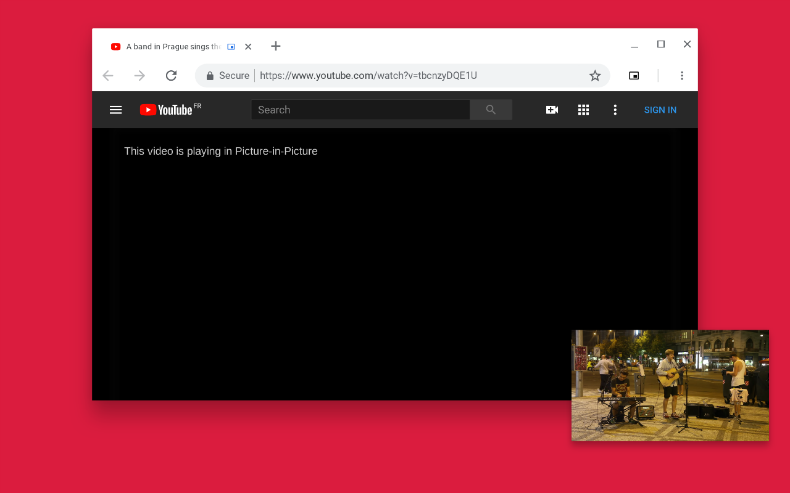

# Picture-in-Picture Fix

A Chrome extension that enables Picture-in-Picture (PiP) on websites that normally disable it.

Based on [Google's Picture-in-Picture Chrome Extension](https://github.com/GoogleChromeLabs/picture-in-picture-chrome-extension), this extension overrides the `disablePictureInPicture` restriction, allowing you to watch videos in a floating, always-on-top window while browsing other websites or using other applications.

Some streaming services use additional restrictions, so Picture-in-Picture may not be available on every website.

## Installation

1. Download or clone this repository.
2. Open `chrome://extensions` in Chrome.
3. Enable **Developer mode**.
4. Click **Load unpacked**.
5. Select the `src` directory.

## Configuration

The keyboard shortcut defaults to `Alt + P` (`⌥ + P` on macOS).

You can change it on the Chrome Extension Shortcuts settings page:

`chrome://extensions/shortcuts`

## Credits

Based on the [Picture-in-Picture Chrome Extension](https://github.com/GoogleChromeLabs/picture-in-picture-chrome-extension) originally developed by Google.

Licensed under the [Apache License 2.0](LICENSE). See the LICENSE file for details.

This project is independently maintained by CodeSlayer and is not affiliated with or endorsed by Google.
